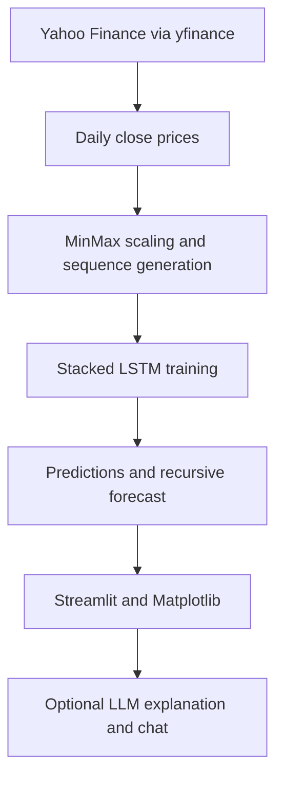

# NeuroBlock — LSTM Cryptocurrency Forecasting

   

An end-to-end educational time series forecasting prototype that retrieves cryptocurrency price data, trains a stacked LSTM model and visualizes historical predictions and future forecasts in Streamlit. An optional LLM integration provides natural-language explanations and interactive questions about the forecast.

## Features

- Historical daily closing prices retrieved using `yfinance` (default: BTC-USD).
- Rolling 60-day input sequences and chronological 80/20 train/test split.
- Stacked LSTM regression model with recursive multi-day forecasts.
- Interactive forecast horizon from 1 to 30 days in Streamlit (default: 15).
- Actual, training, test and forecast curves with latest price and projected percentage change.
- Optional LM Studio or IBM watsonx integration for forecast explanation and chat.

## Architecture



## Model configuration

| Parameter | Implementation |
|---|---|
| Historical window | Latest one year of daily data |
| Input feature | Closing price |
| Lookback | 60 observations |
| Split | 80% training / 20% testing, chronological |
| Network | LSTM(50) → LSTM(50) → Dense(25) → Dense(1) |
| Optimizer | Adam |
| Loss | Mean squared error |
| Epochs | 5 |
| Batch size | 1 in notebook; 16 in Streamlit app |
| Forecast method | Recursive prediction using prior predicted values |

## Evaluation and limitations

The notebook and application generate training and held-out predictions and visualize them against observed prices. They do not currently report a reproducible MAE/RMSE/MAPE benchmark or compare against a naive persistence model.

**Known evaluation issue:** The scaler is fitted to the full series before splitting into training and test sets. This introduces look-ahead leakage. A stronger evaluation should fit the scaler on training observations only, transform the test data separately, and use walk-forward validation.

Test predictions use observed historical windows, whereas future multi-step forecasts feed predictions back into the input. These are different evaluation settings. Recursive errors may accumulate, and the model does not provide uncertainty intervals. Results also change with the data download date and random initialization.

## Repository contents

| File | Description |
|---|---|
| [LSTM_Project.ipynb](LSTM_Project.ipynb) | Model experimentation and forecasting notebook |
| [LSTM_ST.py](LSTM_ST.py) | Interactive Streamlit application |
| [llm_provider.py](llm_provider.py) | LM Studio and IBM watsonx integration |
| [requirements.txt](requirements.txt) | Original environment dependency snapshot |
| `Pic1.png`, `Pic2.png` | Application image assets |
| `.gitignore` | Git exclusions |

## Local setup

```bash
git clone https://github.com/kartavyabh24/NeuroBlock-LSTM-Time-Series-Forecasting-by-Kartavya.git
cd NeuroBlock-LSTM-Time-Series-Forecasting-by-Kartavya
python -m venv .venv
```

Activate the environment on macOS/Linux with `source .venv/bin/activate`, or on Windows PowerShell with `.venv\Scripts\Activate.ps1`.

The original requirements snapshot includes macOS-specific packages (including `tensorflow-metal` and `appnope`) and may have incompatible dependency pins on other systems. For a portable starting point, use Python 3.11 and install the core dependencies:

```bash
python -m pip install --upgrade pip
python -m pip install "tensorflow==2.16.2" "numpy<2" pandas scikit-learn matplotlib yfinance streamlit requests openai jupyterlab
```

This is a suggested environment, not a verified lockfile. TensorFlow installation depends on OS and hardware support.

### Run the notebook

```bash
jupyter lab
```

Open `LSTM_Project.ipynb` to explore the modeling cells. Use `LSTM_ST.py` for the current standalone dashboard instead of the older Streamlit example embedded in the notebook.

### Run the dashboard

```bash
streamlit run LSTM_ST.py
```

Select a cryptocurrency symbol and forecast horizon, then click **Predict**. Internet access is required for market data.

## Optional LLM setup

Forecasting can be used without calling an LLM provider. To enable explanations or chat, configure one of the following:

| Provider | Configuration |
|---|---|
| LM Studio | Start the local server at `http://localhost:1234/v1`, load a model and enter its model name in the app. The `openai` package is used as an API-compatible client. |
| IBM watsonx | Set `IBM_API_KEY` and either `IBM_PROJECT_ID` or `IBM_SPACE_ID` in your environment. Optionally set `IBM_URL` for your service region. Select an accessible model ID in the app. |

Never commit API credentials. The LLM describes model outputs; it does not independently validate or improve the LSTM forecast.

## Future improvements

- Eliminate preprocessing leakage and introduce walk-forward validation.
- Compare with a persistence baseline and report MAE, RMSE and MAPE where appropriate.
- Add fixed evaluation dates, random seeds, automated tests and a portable dependency lockfile.
- Explore additional features and prediction intervals.

## Skills demonstrated

Python · Time series analysis · Deep learning · Data preprocessing · TensorFlow/Keras · API integration · Streamlit · Interactive visualization · LLM integration

## Disclaimer

This is an educational forecasting prototype, not a validated trading system or financial advice.

## Author

**Kartavya Bhardwaj** — M.S. Data Science, Saint Peter's University  
[LinkedIn](https://www.linkedin.com/in/kartavya24) | [GitHub](https://github.com/kartavyabh24)
